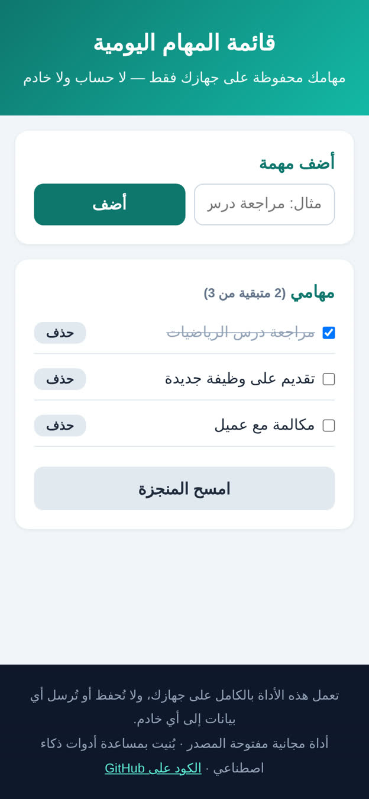

# To-Do List | قائمة المهام اليومية

A simple, fast to-do list saved only on your device: add tasks, check off what you finish, delete what is done. Arabic interface.

**Live app:** https://abood-ayman.github.io/todo-list-ar/

This is a personal project, built with AI tools.

## Features
- Add tasks, mark them done, delete finished ones
- Auto-saved in your browser (localStorage), survives closing the page
- Remaining counter and a progress bar that moves with you
- One button to clear all completed tasks

## Privacy
Everything runs in your browser. No data is stored or sent anywhere.

## Run locally
Open `index.html` in any browser. It is a single static page with no dependencies.

## Status
Stable.

## Copyright
MIT License - Copyright (c) 2026 Abdullah Ayman.
